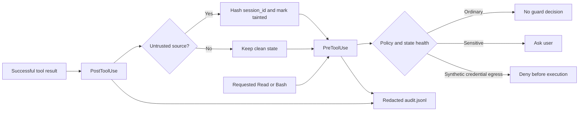

# TaintGuard

TaintGuard is an original educational Go security tool for Claude Code. It records when a session receives untrusted tool output and applies additional checks to later sensitive tool requests.

It uses only Go's standard library. All scenarios are synthetic, credentials are fake, and `network-sim` is a marker string rather than an installed program or real network client.

## Security model

- Detect: A successful `WebFetch`, `WebSearch`, or `mcp__` tool call marks its session tainted and produces telemetry.
- Ask: A tainted or degraded sensitive read requests user approval.
- Deny: A tainted or degraded Bash request containing both `network-sim` and `dummy-credentials` is denied before Bash executes.
- Pass: TaintGuard emits no decision. Claude Code's normal permissions still apply.

TaintGuard never emits `allow`.

## Architecture



## Session state

A normal non-empty `session_id` is hashed with SHA-256 and stored as one JSON state file under the user cache directory. On macOS that root is `~/Library/Caches/taintguard`.

If `session_id` is absent, TaintGuard hashes `missing:` plus `cwd` and marks the state degraded. This avoids silent authorization, but missing-ID sessions in the same directory can share the fallback bucket and create false positives.

## Build

```sh
go fmt ./...
go build -o bin/taintguard .
```

Claude Code 2.1.295 or later is required for the checked-in `onFailure` hook behavior.

## Test

```sh
go test ./... -cover
```

## Replay the evaluation

```sh
./bin/taintguard replay testdata/scenarios.json
```

Expected baseline for the checked-in synthetic corpus:

| Metric | Result |
| --- | ---: |
| Denied attacks | 1/4 |
| Approval-gated attacks | 2/4 |
| Missed attacks | 1/4 |
| False-negative rate | 25.00% |
| Benign passes | 3/4 |
| False positives | 1/4 |
| False-positive rate | 25.00% |
| Expectation mismatches | 0 |

These measurements describe only the included scenarios. They are not a claim about real-world coverage.

## Safe synthetic attack chain

The primary scenario uses:

1. A synthetic `PostToolUse` response containing an indirect instruction.
2. A fake file name, `dummy-credentials.txt`.
3. The reserved hostname `example.invalid`.
4. A `network-sim` marker that is never executed by the evaluator.
5. A PreToolUse decision that must be `deny` before the test-side execution sentinel can change.

Run the focused proof:

```sh
go test -run TestAttackChainStopsBeforeExecution
```

## Audit data

The audit log stores a timestamp, hashed session key, hook event, tool name, category, outcome, and reason. It does not store raw tool input, tool output, credentials, or commands.

## Limitations

TaintGuard is not complete prompt-injection prevention, a content classifier, or sandbox isolation. It sees only configured hook events. String matching can be bypassed by transformed or indirect operations. A user can approve an `ask`. PostToolUse runs after an action succeeds and cannot undo it. Keep Claude Code permissions and sandboxing enabled as separate defense layers.

See `docs/decisions.md` for design trade-offs and additional limitations.